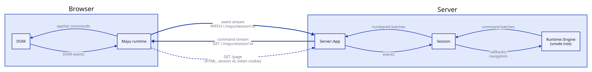
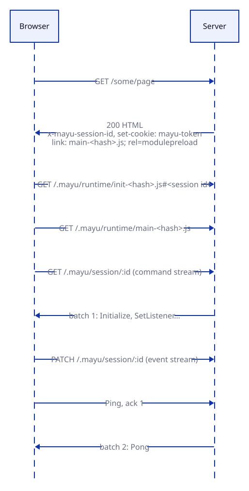
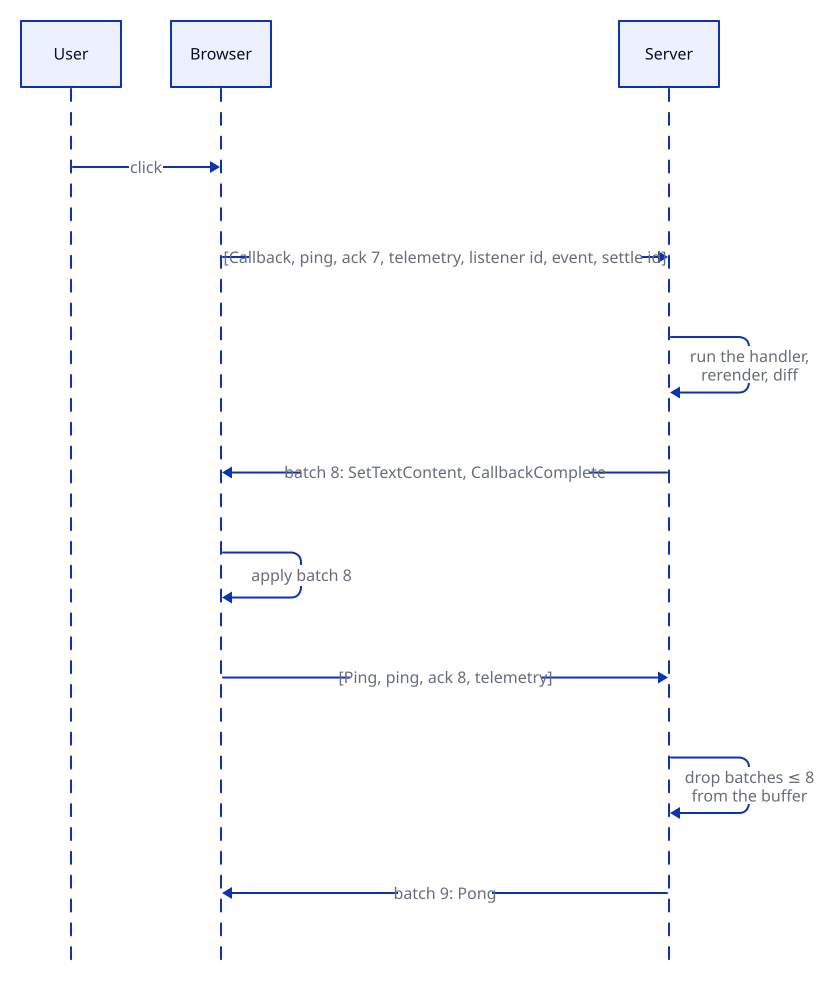
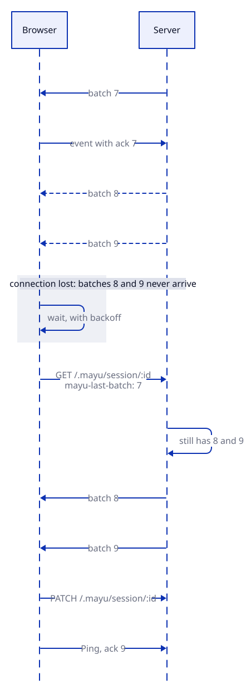
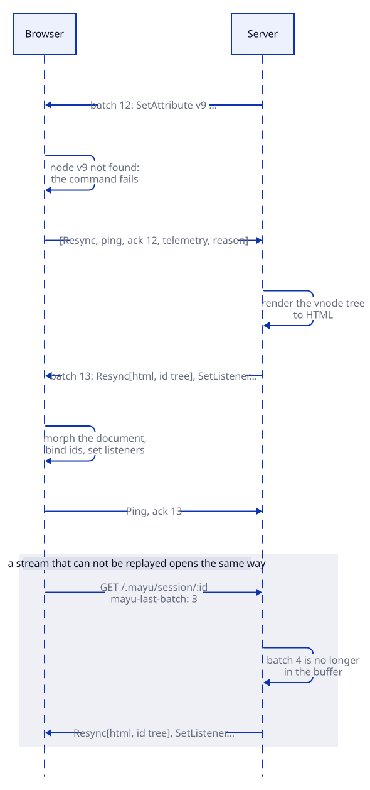
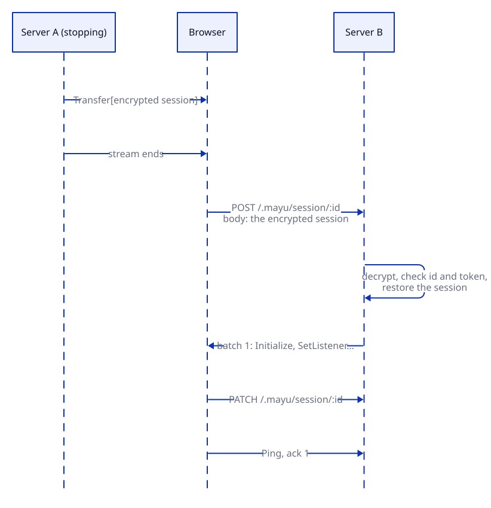

# The wire protocol

How a Mayu page and its server talk to each other. The server keeps the
state and a tree of what the page shows. It sends the browser commands that
change the DOM, and the browser sends back what the user does.



A page has one session on the server and two long-lived requests to it:

- the **command stream**, from the server to the browser
- the **event stream**, from the browser to the server

Everything on both is [MessagePack](https://msgpack.org/).

The names in this document are checked by tests.
`gems/mayu-live/lib/mayu/client/protocol.json` lists the commands, events
and error codes, and a test on each side holds its code to that list.

## Requests

| Request                     | What it is                                         |
| --------------------------- | -------------------------------------------------- |
| `GET /any/page`             | The page as HTML. Starts a session.                |
| `GET /.mayu/runtime/<file>` | The browser runtime.                               |
| `GET /.mayu/assets/<file>`  | The app's assets.                                  |
| `GET /.mayu/session/:id`    | Opens the command stream.                          |
| `POST /.mayu/session/:id`   | Opens the command stream of a transferred session. |
| `PATCH /.mayu/session/:id`  | The event stream.                                  |

The session requests use the content type
`application/vnd.mayu.event-stream`. The body of the `POST` is
`application/vnd.mayu.session`.

The page response carries two things the runtime needs:

- `x-mayu-session-id`, which is also the fragment of the runtime's script
  URL (`init-<hash>.js#<session id>`).
- A `mayu-token` cookie. It is `HttpOnly`, `SameSite=Strict`, and scoped to
  `/.mayu/session/:id`, so the browser sends it with the session requests
  and nowhere else. It has no expiry: the page must still have it when it
  reconnects.

A session request without the right cookie is refused.

## Loading a page



The HTML is complete: the page is readable before the runtime has loaded.
The first batch, `Initialize`, gives the browser the id of every node the
server rendered. From then on commands name nodes by id.

The session starts running when its command stream opens. Until then
nothing in it changes, so the HTML and the ids agree.

## The command stream

The response body is a sequence of frames:

```
[4 bytes: length of the payload, big-endian][payload]
```

The payload is one batch as MessagePack:

```
[seq, [command, command, …]]
```

`seq` is the number of the batch. It starts at 1 for each session and goes
up by one. A command is an array of its name and its arguments:

```
["SetTextContent", "v12", "Count: 3"]
```

The browser applies a batch in order and waits for a command that takes
time, such as a view transition, before the next. If a command fails, the
rest of the batch is still applied.

The stream as a whole is compressed with `deflate-raw`
(`content-encoding`), unless `command_stream_compression` is off in
`mayu.toml`.

### Commands

The page and its nodes:

| Command             | Arguments                   | What it does                                         |
| ------------------- | --------------------------- | ---------------------------------------------------- |
| `Initialize`        | `id_tree`                   | Binds ids to the nodes the page already has.         |
| `Resync`            | `html`, `id_tree`           | Replaces the document with the server's, then binds. |
| `CreateTree`        | `html`, `tree`              | Parses HTML into new nodes and binds their ids.      |
| `ReplaceChildren`   | `id`, `child_ids`           | Sets the children of a node, in this order.          |
| `RemoveNode`        | `id`                        | Forgets a node and what is under it.                 |
| `SetTextContent`    | `id`, `content`             |                                                      |
| `SetAttribute`      | `id`, `name`, `value`       |                                                      |
| `RemoveAttribute`   | `id`, `name`                |                                                      |
| `AddClass`          | `id`, `classes`             |                                                      |
| `RemoveClass`       | `id`, `classes`             |                                                      |
| `SetCSSProperty`    | `id`, `name`, `value`       |                                                      |
| `RemoveCSSProperty` | `id`, `name`                |                                                      |
| `SetListener`       | `id`, `name`, `listener_id` | Listens for an event and reports it as a callback.   |
| `RemoveListener`    | `id`, `name`, `listener_id` |                                                      |
| `ViewTransition`    | `batch`, `types`, `scope`   | Applies a batch inside a view transition.            |

An id tree is `{id, name, children}` for every node, where `name` is the
node name the server expects, such as `DIV` or `#text`. A new node is
created with `CreateTree` and put in place with `ReplaceChildren`.

Answers to what the browser sent:

| Command              | Arguments              | Answers                                     |
| -------------------- | ---------------------- | ------------------------------------------- |
| `Pong`               | `timestamp`            | `Ping`, with the time the browser sent.     |
| `CallbackComplete`   | `id`                   | A `Callback` that had a settle id.          |
| `CallbackFailed`     | `id`                   | The same, when the handler raised.          |
| `NavigationComplete` | `id`                   | `Navigate`.                                 |
| `NavigationFailed`   | `id`                   | `Navigate`.                                 |
| `DocumentNavigation` | `id`, `href`           | `Navigate` to something that is not a page. |
| `InspectResult`      | `request_id`, `result` | `Inspect`, from the devtools.               |

Everything else:

| Command                 | Arguments              | What it does                                   |
| ----------------------- | ---------------------- | ---------------------------------------------- |
| `BrowserAction`         | `name`, `args`         | `browser.navigate`, `browser.alert` and so on. |
| `ElementCall`           | `id`, `method`, `args` | Calls a method on an element, for a ref.       |
| `RegisterCustomElement` | `name`, `path`         | Imports the module of a custom element.        |
| `RenderError`           | the error              | Shows the error overlay (`render_exceptions`). |
| `ReloadSucceeded`       |                        | Removes it after a hot reload that works.      |
| `Transfer`              | `payload`              | Hands the session to the browser, encrypted.   |
| `TransferFailed`        |                        | The session could not be handed over.          |

## The event stream

The browser sends one frame per event:

```
[1 byte: encoding][4 bytes: length of the payload, big-endian][payload]
```

Encoding 0 is plain MessagePack. Encoding 1 is `deflate-raw`, used for an
event of 512 bytes or more when that makes it smaller. A frame may be at
most 1 MB.

Where the browser can stream a request body, all frames go into one
`PATCH` that stays open. Where it can't, every
frame is its own `PATCH`. The bytes are the same.

Every event starts with the same four fields:

```
[name, ping, ack, telemetry, …arguments]
```

- `ping` is the browser's clock when it sent the event.
- `ack` is the number of the last batch the browser applied, or `null`.
- `telemetry` is `null`, or how long the browser spent applying batches
  since its last event: `{batches, commands, duration_ms}`.

| Event        | Arguments                            | Sent when                                 |
| ------------ | ------------------------------------ | ----------------------------------------- |
| `Callback`   | `listener_id`, `event`, `settle_id`? | An event fires on a node with a listener. |
| `Navigate`   | `id`, `href`                         | The user follows a link or goes back.     |
| `Ping`       |                                      | Every four seconds without another event. |
| `Visibility` | `hidden`                             | The tab is hidden or shown.               |
| `Inspect`    | `id`, `query`                        | The devtools ask about a node.            |
| `Resync`     | `reason`                             | A command could not be applied.           |

Events are sent at most once. One that was on its way when the connection
dropped is gone, and is not sent again: a click that runs twice is worse
than one that is lost. A caller that needs to know passes a settle id and
gets `CallbackComplete` or `CallbackFailed`, or a rejection when the
connection is lost first.

## An event and its answer



The server keeps every batch it has sent until the browser acknowledges it,
up to 256 batches or 1 MB. The `ack` in each event tells it what it can
drop. A page that is doing nothing still pings every four seconds, so the
buffer stays small.

## Reconnecting

When either stream ends, the browser closes both and opens both again. It
waits longer after each failure in a row, up to ten seconds.



The new `GET` names the last batch the page applied in a `mayu-last-batch`
header. What the stream starts with depends on that:

| The browser sends     | The server                              | The stream starts with |
| --------------------- | --------------------------------------- | ---------------------- |
| no header             | has sent nothing yet                    | `Initialize`           |
| `mayu-last-batch: 7`  | still has every batch after 7           | batches 8, 9, …        |
| `mayu-last-batch: 7`  | no longer has them                      | `Resync`               |
| no header             | has sent batches the page never applied | `Resync`               |
| `mayu-last-batch: -1` |                                         | `Resync`               |

The browser sends `-1` after a batch it could not decode, so that it is not
sent the same bytes again.

A replay loses nothing and changes nothing else: the page keeps its nodes
and listeners. A second stream for a session takes over from the first,
which the server closes.

## When the page and the server disagree

A command fails when the page is not what the server thinks it is: a node
it names is missing, or the ids in an id tree don't line up with the
document. The browser then asks for the whole page.



`Resync` carries the page as the server's tree has it now. The browser
morphs its document into that, so nodes the two share stay where they are
and keep their focus and scroll position. Form fields take the server's
values. The session and its state are untouched.

If the page still differs within five seconds of a resync, the difference
is one the server can't repair, such as markup the browser corrects while
parsing. The browser logs it and asks for no more.

## Moving a session to another server

A server that is stopping hands its sessions to the browsers, which bring
them to another server.



The payload of `Transfer` is the session, serialised and encrypted with a
key the servers share. It is valid for a short time
(`transfer_timeout_seconds`). The browser can't read it and holds it only
until a server has accepted it.

The server that resumes the session starts counting batches from 1 again
and opens with `Initialize`, since the page is as the first server left
it.

## Errors

A session request that fails is answered with JSON:

```json
{ "code": "SESSION_NOT_FOUND", "message": "SESSION_NOT_FOUND" }
```

The browser acts on `code`. For some codes the session is gone for good,
and the browser starts a new one: it fetches the page again, morphs the
document into it, and connects to the session of that response. Component
state is lost. For the others it tries again after a delay.

| Code                           | Status | The browser          |
| ------------------------------ | ------ | -------------------- |
| `SESSION_NOT_FOUND`            | 403    | starts a new session |
| `TOKEN_COOKIE_NOT_SET`         | 403    | starts a new session |
| `SESSION_EXPIRED`              | 403    | starts a new session |
| `SESSION_CIPHER_ERROR`         | 403    | starts a new session |
| `SESSION_RESTORE_FAILED`       | 422    | starts a new session |
| `SESSION_ID_MISMATCH`          | 403    | tries again          |
| `INVALID_TOKEN`                | 403    | tries again          |
| `SESSION_NOT_ACCEPTING_EVENTS` | 409    | tries again          |
| `INVALID_EVENT_MESSAGE`        | 400    | tries again          |
| `EVENT_MESSAGE_TOO_LARGE`      | 413    | tries again          |
| `SERVER_STOPPING`              | 503    | tries again          |
| `INTERNAL_SERVER_ERROR`        | 500    | tries again          |

`TransferFailed` on the command stream also starts a new session.

## Where it is implemented

| Part                       | Server                                           | Browser (`client/src`)                               |
| -------------------------- | ------------------------------------------------ | ---------------------------------------------------- |
| Commands                   | `runtime/commands.rb`                            | `protocol/commands.ts`                               |
| Events                     | `session.rb` (`Session::Events`)                 | `protocol/events.ts`                                 |
| Framing                    | `server/event_stream.rb`                         | `protocol/batch-codec.ts`, `protocol/event-codec.ts` |
| Requests, replay, takeover | `server/app.rb`                                  | `connection/`                                        |
| Numbering and the buffer   | `session.rb` (`stamp_batch`)                     | `connection/session-connection.ts`                   |
| Resync                     | `runtime/engine.rb`, `runtime/vnodes/updater.rb` | `features/resync.ts`, `dom/handlers.ts`              |

Server paths are under `gems/mayu-live/lib/mayu/`.
`gems/mayu-live/lib/mayu/client/src/README.md` describes the browser side
module by module.

## The diagrams

The diagrams are [D2](https://d2lang.com/) files in `docs/protocol/`. After
changing one, render it again:

```sh
d2 --theme 0 --dark-theme 200 --pad 20 docs/protocol/reconnect.d2 docs/protocol/reconnect.svg
```
